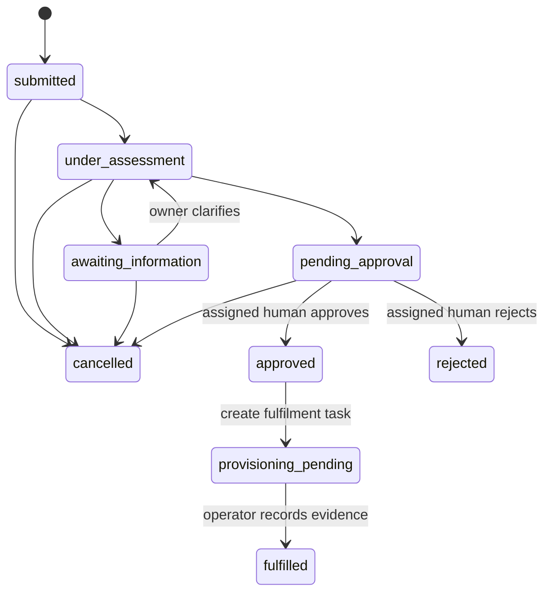

# Data and workflow design
Users belong to a department and a database role, and may reference an assigned manager.
Applications hold a deterministic entitlement allow-list. One policy per application owns
immutable versions; versions contain digest, expiry, plain text and overlapping chunks.
Requests contain owner, application, justification, access level, status, revision, timestamp,
idempotency key and original payload hash. Assessments reference the request and persist typed
advisory output, deterministic eligibility, provider and trace/latency/usage metadata. Evidence
rows reference immutable policy versions and chunks. Decision and fulfilment rows use request
ID as primary key, preventing a second decision/task. Comments and audit rows reference requests.
Integration event IDs deduplicate signed callbacks; workflow executions track external ID and expiry.



Rejected, cancelled and fulfilled are terminal. Approved is a persisted intermediate transition
inside the decision transaction; clients normally see provisioning_pending. There is no draft
state because create immediately submits. Expired approval executions retain pending_approval
business state and require administrator renewal; maintenance marks escalation required.

```mermaid
sequenceDiagram
 participant E as Employee
 participant A as API
 participant P as Policy/AI boundary
 participant D as Database
 participant M as Manager
 participant O as Operator
 E->>A: Create + idempotency key
 A->>D: Lock owner; validate key and entitlement
 A->>P: Redact; retrieve permitted evidence; assess
 P-->>A: Validated advisory output + citations
 A->>D: Request, assessment, evidence, transitions, audit, workflow
 A-->>E: Actual persisted ID/status
 M->>A: Decision + reason
 A->>D: Lock request; check assigned manager, no self-approval, expiry
 A->>D: Unique decision + fulfilment task + audit
 O->>A: Record verified fulfilment reference
 A->>D: Validated transition + audit
```

Every successful operation is a unit of work committed by get_db; exceptions roll back. Policy
and cloud calls currently execute inside the transaction. This favours simple atomic local
semantics over throughput; use an outbox/worker before large deployments. Remote index writes
cannot participate in the database transaction: retrieval revalidates canonical version and ACL,
and an idempotent reindex command repairs incomplete indexing. Outbound workflows deduplicate
by request ID because an HTTP response can be lost after remote execution. PostgreSQL row locks
and DB constraints back idempotency; SQLite is an explicitly separate single-process demo option.

Authentication uses MSAL authorization code/PKCE in the web app and delegated OAuth in Copilot.
API verifies RS256 signature, tenant issuer, audience, expiry, nbf and delegated scopes with JWKS.
The oid maps to a pre-onboarded database user. Frontend labels and token role labels do not grant
application privileges. Employee connector client is confined to /v1/tools and per-tool scopes.
