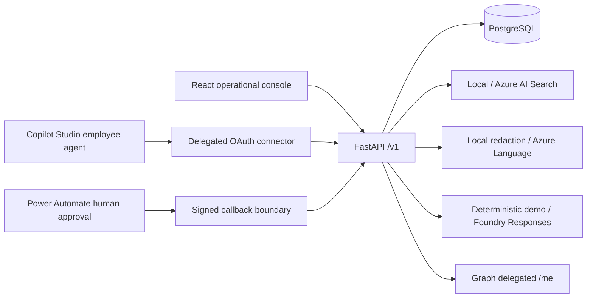

# Architecture

The backend alone owns business state, permissions, approvals and fulfilment.
Assessment output is advisory. Human operators record fulfilment; no directory writes exist.
PostgreSQL is the primary database. Explicit SQLite mode supports local exploration when
PostgreSQL is unavailable and does not establish PostgreSQL compatibility.
Demo identity selection is enabled only outside production. Azure mode requires Entra
access tokens and all configured providers; there is no provider fallback.

Stages: foundation; persistence; lifecycle; console; AI/providers; Microsoft contracts;
security and verification; delivery preparation. Each stage has a verification record.
