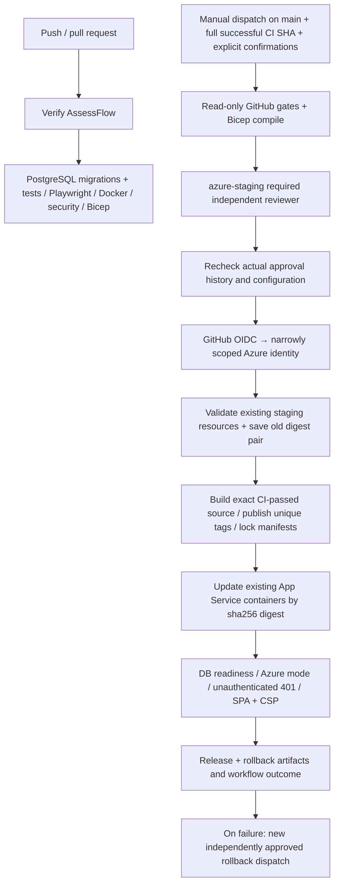

# Manually approved Azure staging releases

**Implemented automation; not activated or executed against Azure.** The existing verification
workflow is separate from `.github/workflows/deploy-staging.yml`. Adding this file does not
create an environment, federated identity, registry, application, database or AI resource.
The staging workflow has **workflow_dispatch only**: no push, PR, workflow_run or scheduled
trigger. Do not dispatch it during local release preparation.

## CI/CD architecture

Infrastructure validation means local foundation Bicep compilation plus authenticated checks of
existing registry/apps/identity/configuration before changes. This workflow **does not apply the
foundation template**, run ARM provisioning, create a resource group, migrate a database or
publish a Copilot agent. An initial staging foundation must be separately authorised and ready.
The two small release scripts use only Python's standard library and the runner's GitHub/Azure
CLIs. No application features, UI, dependencies or provider architecture are replaced.

## Required GitHub configuration (operator action, not performed)

1. Protect `main`, review workflow changes, and restrict who can dispatch workflows. Create
   an environment named **azure-staging**. Add at least one required reviewer other than the
   expected dispatcher; enable **Prevent self-review** and disallow administrator bypass.
   Select deployment branches/tags: **exactly the branch main**, no tags or wildcard rules.
2. Required reviewers depend on repository visibility and GitHub plan. This repository was
   observed public; do not assume equivalent protections on a private fork or another plan.
   If the plan cannot enforce reviews, leave deployment disabled. Never remove checks to
   work around missing protection features.
3. The preflight queries the existing environment and its branch policies before starting the
   environment job. Missing environment (404), missing reviewers, self-review permission or
   non-main policies fail closed. Merely referencing an auto-created environment is insufficient.
   After the GitHub approval gate, the job queries actual run review history; an independent
   approved azure-staging review is required before Azure login. An admin bypass alone is not
   accepted. Restrict environment changes to administrators and do not edit protection while
   a release is pending. Review history checks are run-specific; protect reruns like releases.
4. Configure the following **environment variables** in azure-staging. They contain identifiers
   and public application configuration, not an Azure client secret or database password.

| Variable | Required value |
|---|---|
| STAGING_ENABLED | Literal `true`, only after completing the setup/review checklist |
| AZURE_CLIENT_ID | Deployment identity application/client UUID |
| AZURE_TENANT_ID | Tenant UUID |
| AZURE_SUBSCRIPTION_ID | Approved staging subscription UUID |
| AZURE_RESOURCE_GROUP | Existing dedicated staging resource group |
| AZURE_ACR_NAME | Existing registry name in that resource group |
| AZURE_API_APP / AZURE_WEB_APP | Distinct existing Linux custom-container App Service names |
| STAGING_API_URL / STAGING_WEB_URL | Exact HTTPS default app origins, no path/port/query |
| VITE_ENTRA_TENANT_ID | SPA tenant UUID |
| VITE_ENTRA_CLIENT_ID | SPA registration UUID, distinct from the deployment identity |
| VITE_ENTRA_SCOPE | Actual API delegated scope, e.g. `api://API_UUID/access_as_user` |

No production environment, deployment environment settings, secrets or OIDC credential has
been created as part of this iteration. An absent STAGING_ENABLED flag remains a hard stop.

## Required Azure configuration (operator action, not performed)

Configure a federated credential on a dedicated deployment application/user-assigned identity:

- Issuer: `https://token.actions.githubusercontent.com`
- Subject: `repo:keenosmith-del/ms-assessflow:environment:azure-staging`
- Audience: `api://AzureADTokenExchange`

Bind to the exact repository/environment, never a wildcard or branch-only credential. The
preflight job has no id-token permission; only the protected staging job has id-token:write.
Azure/login exchanges the short-lived token; no client secret or publish profile is used.

Grant narrow resource-scoped read/configuration permissions on the two staging apps (including
sites/config read/write and appsettings list), registry read and repository push/metadata-lock
permissions for `assessflow-api` and `assessflow-web`. Choose supported registry roles for your
RBAC/ABAC mode; verify permission to lock manifests/tags. Do not grant Owner, subscription-wide
Contributor, role-assignment rights, database administration or foundation provisioning rights.
A dedicated staging resource group and identity scope limit accidental production targeting.
The deployment identity can read sensitive app settings; the script captures them privately and
only artifacts a whitelist of app names/image references. Do not enable shell tracing/debug logs.

Existing apps must have `environment=staging` tags, HTTPS, system managed identity, registry pull
via managed identity and working AcrPull/data-plane permissions. The prepared foundation now
applies the environment tag to both apps. Configure Entra, AI endpoints, Key Vault DB reference,
production Azure operating mode, CORS and container ports before enabling releases. Both apps
must already run an immutable `REGISTRY/assessflow-{api,web}@sha256:...` baseline; mutable `latest`
or tag-only baselines are rejected because they cannot provide a reliable rollback snapshot.
Initial bootstrap, identity grants, network access, migrations and tenant onboarding stay in the
separately approved foundation runbook. No automatic synthetic seed runs in this workflow.

## Release and evidence

Select the workflow from **main**, supply a full lowercase 40-character release_sha, choose
`deploy`, type **DEPLOY STAGING**, and confirm schema compatibility/backup review. Preflight
requires that SHA be an ancestor of main and have a completed successful **verify.yml push run
on main**. PR checks or a green run for a different SHA do not qualify. The trusted workflow and
gate scripts come from the dispatch revision on main; only image source is checked out at the
selected verified SHA. CI success is a prerequisite, not deployment verification.

After independent approval, the job validates existing Azure state and uploads
`staging-before-RUN_ID-ATTEMPT` **before mutation**. This includes both old digest references,
app names and registry/resource-group identifiers, never app settings/credentials. Build tags
include commit SHA, run ID and attempt so retries cannot replace a previous build. Images carry
`org.opencontainers.image.revision`, target linux/amd64, are pushed to the existing registry,
then tags and manifest digests are write/delete locked. App Service receives the immutable digest,
never a mutable tag. Source SHA alone does not imply bit-for-bit reproducibility: base-image tags
and external build tools can change; the captured content digests identify the exact built bytes.

The workflow revalidates staging state immediately before the two container updates and
rejects a changed baseline relative to the saved recovery snapshot. Releases
are serialised and never cancel an in-flight deployment. Updates are sequential, **not atomic**.
The before snapshot remains available even if the second app update or subsequent smoke fails.
Release evidence includes revision/new digests in `staging-release-RUN_ID-ATTEMPT`; artifacts
are retained 30 days, so archive approved manifests externally for longer rollback retention.

Smoke tests check database readiness, Azure mode, unauthenticated rejection, web root/deep-link
and CSP. They do not call Foundry/Language/Graph, authenticate as an employee, prove model quality,
publish an agent, or certify App Service has finished replacing every old worker. Inspect runtime
startup/image logs and perform authorised authenticated tenant checks before declaring a live
release accepted. Configuration success and basic smoke success are distinct evidence.

## Rollback and partial failures

1. On failure, leave the workflow failed and inspect its summary, Azure container startup logs
   and the **before** artifact. Do not claim success or automatically downgrade a database.
2. Verify the recorded pair belongs to the intended previous release, remains available/locked,
   and is compatible with the current schema. Review a backup/PITR plan first. This workflow
   never applies migrations; schema changes require a separate reviewed migration/recovery job.
3. Dispatch the **same workflow from main** with `operation=rollback`, previous release's
   successful CI SHA, previous `sha256:...` API/web digests from its successful manifest, both
   confirmations, and a new independent environment approval. The workflow pulls the old
   digests and verifies both image revision labels match that SHA; it rebuilds neither image.
4. The old pair is promoted through the same existing-resource checks and smoke tests, with
   another before/release artifact. Restore both components after a partial deployment; avoid
   mixing image pairs. Old mutable or unlabelled bootstraps require a separately approved
   manual recovery plan rather than bypassing validation.
5. If database recovery is necessary, stop application writes and follow the database rollback
   runbook, restore to a separate database, validate/reindex/reconcile, then reconfigure under
   approval. A container rollback cannot undo a database change.

OIDC federation, image publication/locks, Azure target validation, actual promotion, smoke,
rollback, identity/network/provider readiness and approval enforcement in a configured environment
are **not live verified**. Unit tests use synthetic GitHub/Azure responses and static workflow
validation. No deployment workflow was dispatched during this work.

## Official references reviewed 26 October 2026

- [GitHub environment protection](https://docs.github.com/en/actions/reference/workflows-and-actions/deployments-and-environments)
- [Environment REST API](https://docs.github.com/en/rest/deployments/environments)
- [Workflow run review history](https://docs.github.com/en/rest/actions/workflow-runs#get-the-review-history-for-a-workflow-run)
- [Azure/login OIDC](https://github.com/Azure/login#login-with-openid-connect-oidc-recommended)
- [App Service container configuration](https://learn.microsoft.com/en-us/azure/app-service/configure-custom-container)
- [ACR image locks](https://learn.microsoft.com/en-us/azure/container-registry/container-registry-image-lock)
